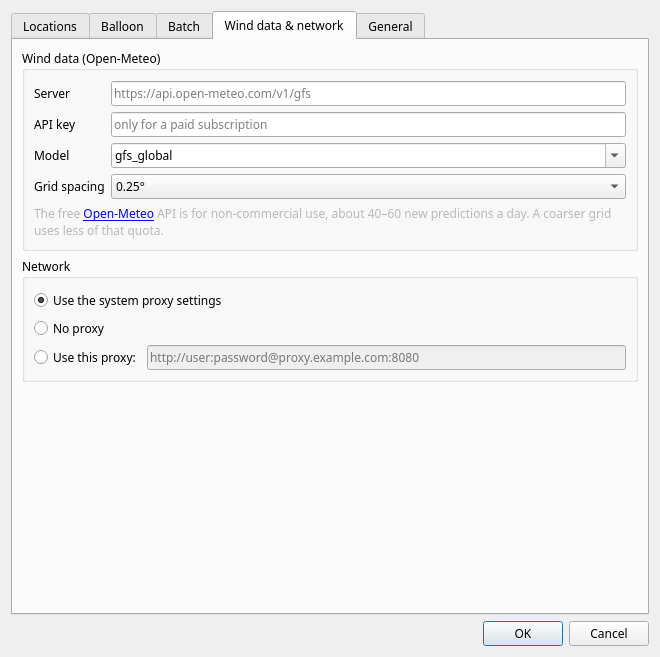

# Sonde Predict 5 — user manual

Sonde Predict calculates where a radiosonde will come down after its weather balloon bursts, so
you can tell at a glance whether a launch is worth hunting. It takes the upper-air winds from the
Global Forecast System (GFS), flies the balloon through them second by second, and shows the
track, the burst and the landing point on a map, together with the distance and direction from
your own location.

Sonde Predict 5 is a rewrite of Sonde Predict v3 (2016–2022). The idea and the workflow are the
same; what changed is listed in [Coming from Sonde Predict v3](#coming-from-sonde-predict-v3).


## Contents

1. [Installing](#installing)
2. [First start](#first-start)
3. [The main window](#the-main-window)
4. [Making a prediction](#making-a-prediction)
5. [Reading a prediction](#reading-a-prediction)
6. [Batch predictions and the scheduler](#batch-predictions-and-the-scheduler)
7. [Google Earth, KML and GPX](#google-earth-kml-and-gpx)
8. [Settings](#settings)
9. [Choosing the balloon settings](#choosing-the-balloon-settings)
10. [Wind data and its limits](#wind-data-and-its-limits)
11. [Command line](#command-line)
12. [Troubleshooting](#troubleshooting)
13. [Coming from Sonde Predict v3](#coming-from-sonde-predict-v3)
14. [Where Sonde Predict keeps its files](#where-sonde-predict-keeps-its-files)
15. [Credits](#credits)

## Installing

Download Sonde Predict from <https://github.com/oh2gba/SondePredict/releases/latest>.

**Windows** (Windows 10 and 11, 64-bit): run `SondePredict-windows-x64-setup.exe`.
It installs for your user account only, unless you choose otherwise, and adds a Start menu entry.
Uninstall it from *Settings → Apps* like any other program. There is also a zip file: unzip it
anywhere and start `sondepredict.exe`, as with v3 (`SondePredict-windows-x64.zip`). Windows may warn that the installer comes
from an unknown publisher; choose *More info → Run anyway*.

**Linux** (most distributions from 2022 on): download `SondePredict-x86_64.AppImage`, make it
executable and start it:

```bash
chmod +x SondePredict-x86_64.AppImage
```

```bash
./SondePredict-x86_64.AppImage
```

If it complains about FUSE, start it with `--appimage-extract-and-run` added, or install your
distribution's `libfuse2` package. To remove Sonde Predict, delete the file (and, if you want, the
folders listed in [Where Sonde Predict keeps its files](#where-sonde-predict-keeps-its-files)).

Sonde Predict needs an internet connection for wind data and map tiles.

## First start


On the first start there are no locations yet. You need at least a **launch location** (the
sounding station) and usually **your location** (where you hunt from). Either:

* add them under **Edit → Settings → Locations** (see [Locations](#locations)), or
* if you used Sonde Predict v3, choose **File → Import Sonde Predict v3 settings** and pick the
  old `config.ini` from the v3 folder. This brings over your locations (with their warning
  distances), balloon settings, grid size, proxy, Google Earth path, batch schedule and the
  last choices in the main window. Locations you already have are kept as they are. A summary
  tells you what was imported.

## The main window

The window has the same layout as v3, with a map added.

* **Predictions** (top left): every saved prediction, grouped by launch day, newest first. Each
  entry shows the launch site, the launch time and how far from your location the sonde lands.
  An entry is **bold** when that distance is within your location's *Highlight within*
  distance, so good hunting days stand out without opening anything. A day is bold when any of
  its predictions is. Batch predictions say *(batch)* in their tooltip.
  * Click a prediction to show it. Select several with Ctrl or Shift, or click a day to select
    all of its predictions: they are drawn on the map together, which shows at a glance how
    the landing point moves from launch to launch.
  * **Delete** removes the selected predictions.
  * **Google Earth** opens the selected predictions in Google Earth (see
    [Google Earth, KML and GPX](#google-earth-kml-and-gpx)).
* **New prediction** (bottom left): the launch location, your location, the launch date and
  time, **Start**, **Start a batch** and **Run scheduled batch tasks**.
* **Map** (top right): an OpenStreetMap map with the selected predictions. Drag to move, use the
  mouse wheel or a pinch to zoom.
* **Details** (bottom right): the numbers for the selected prediction. Coordinates are links that
  open the spot on openstreetmap.org. You can select text and copy it with Ctrl+C.
* **Status bar**: what Sonde Predict is doing, a progress bar while it works, and the current
  UTC time.


## Making a prediction

1. Choose the **Launch location** and **Your location**. *Your location* can be *(none)*; the
   prediction then has no distance or highlighting.
2. Choose the **Date** and the **Time** of the launch. The time is in UTC, or in your computer's
   time zone if you switched UTC off under *Settings → General*; the label next to the time
   says which. Dates from 7 days back to 15 days ahead can be chosen.
   Many stations launch about 45 minutes before the synoptic hour (for example 11:15 UTC for the
   12 UTC sounding); use the actual launch time, not the synoptic hour.
3. Press **Start**. The status bar shows the progress: Sonde Predict fetches the winds around the
   launch site, flies the balloon, fetches the winds along the track it found, and flies it again
   until no wind data is missing (usually one or two rounds, a few seconds in all). While it
   runs, **Start** turns into **Stop**, which cancels the calculation.
4. The new prediction is saved, appears in the list and is shown on the map.

If you make a prediction again for the same launch time, launch site and your location, the new
one replaces the old one (unless you switched that off under *Settings → General*). Predictions
made within an hour of each other reuse the wind data already downloaded.

## Reading a prediction

On the map, the ascent is blue and the descent red. The green dot is the launch site, the orange
dot the burst, the red dot the landing (labelled with the landing time), and the blue square
your location. The amber ellipse is the **landing area**.

The details panel shows:

* **Landing**: position, time and flight duration, the ground altitude there, the distance and
  bearing from your location (with a compass direction such as NNE) and from the launch site,
  and the size of the landing area.
* **Launch**: the site with its altitude, the launch time, and the burst altitude, time and
  position.
* **Settings used**: the ascent rate, burst altitude and descent model the prediction was made
  with, which wind model it used and when it was calculated.

### The landing area

A single landing point looks more precise than it is. Real balloons climb a little faster or
slower than planned, burst a kilometre or two higher or lower, and fall at slightly different
speeds. Sonde Predict therefore flies each prediction about 50 more times through the same
winds with those values varied, and draws the ellipse that contains 95% of the landings. The
details give its size and the direction of its long axis, for example *18.6 × 13.0 km, long
axis 15°–195° (NNE–SSW)*.

A long, thin area means the sonde travels along a steady wind and only its timing is uncertain:
it will come down somewhere along that line. A round area means the wind changes direction with
height. The area does not include errors in the wind forecast itself, so the true uncertainty is
larger, especially for launches several days ahead. How much the balloon values are varied is set
under [Settings → Balloon](#balloon).

### When the balloon goes very high

GFS winds are available up to the 10 hPa level, about 31 km. If the burst altitude is higher,
Sonde Predict keeps using the wind at the highest level and says so in the details.

## Batch predictions and the scheduler

A batch makes predictions for several days and launch hours in one go, for example the 11:15 and
23:15 UTC launches of today and the next two days.

1. Set it up under **Edit → Settings → Batch**: the launch location, your location, the days
   (*Today*, *Tomorrow*, *In 2 days*, …), the launch hours in UTC, the minute past the hour, and
   how often to repeat it. A line below the lists summarises the batch, for example *4
   predictions per batch from Jokioinen, launches at 11:15, 23:15 UTC*.
2. Press **Start a batch** in the main window. The status bar shows which launch is being
   calculated (*Batch 2/4: Jokioinen 2026-10-22 23:15 UTC…*), and each prediction appears in
   the list as soon as it is ready. **Stop** cancels the rest of the batch; predictions already
   finished are kept.
3. Tick **Run scheduled batch tasks** to repeat the batch automatically every *Repeat every*
   hours while Sonde Predict is open (the tooltip says when the next run is). This needs a
   repeat interval; it is off when *Repeat every* is *only when started by hand*.

Batch predictions replace older ones for the same launch, so a scheduled batch keeps the list up
to date with the newest forecast. Launches within 12 hours of each other share their wind data,
so a batch costs little more than a single prediction per day.

## Google Earth, KML and GPX

**Google Earth** (button below the list) writes the selected predictions to a KML file and opens
it. If you set the Google Earth program under *Settings → General*, Sonde Predict starts it;
otherwise it opens the file with whatever program your system uses for KML files. Google Earth
then shows:

* the ascent and descent as 3D tracks, with a curtain down to the ground and a time slider;
* the wind speed and direction at each point: click the track to see them, as in v3;
* the launch, burst and landing as placemarks, the landing with its time, coordinates and
  distance from your location;
* your location and the 95% landing area.

Each prediction is a folder of its own, so you can switch them on and off.

**File → Export selected as KML** saves the same file wherever you want, for example to share it.

**File → Export selected as GPX** saves the landing and burst points as waypoints and the tracks
as GPX tracks, for GPS receivers and phone navigation apps (OsmAnd, Locus, Organic Maps,
Garmin…). Load it on your phone before you set off and navigate to the landing waypoint.

## Settings

Open the settings with **Edit → Settings** (Ctrl+,). Changes take effect when you press **OK**.

### Locations


The list on the left shows your locations. Click one to change it; press **New** for a new one.
Fill in:

* **Name**: shown in the drop-down lists and the prediction list.
* **Latitude** and **Longitude** in decimal degrees (WGS84, as shown by GPS receivers and map
  sites). Southern latitudes and western longitudes are negative.
* **Altitude** in metres above sea level. For a launch site this matters: the flight starts
  there. Your own location's altitude is not used.
* **Highlight within**: predictions landing closer than this to this location are shown in bold
  when it is *your location*.

Press **Save** to store the location. **Remove** deletes the selected one. A location typed in
but not saved yet is saved when you press OK. Renaming a location keeps the batch and the main
window pointing at it.

### Balloon


* **Ascent rate**: how fast the balloon climbs, in m/s.
* **Burst altitude**: where the balloon bursts, in metres above sea level.
* **Descent**: how fast the sonde falls. Two models are available:
  * **Density-scaled (recommended)**: the sonde falls faster in thin air high up and slows
    down as the air gets denser. *Descent rate at sea level* is the speed near the ground,
    *Density exponent k* how strongly it changes with height.
  * **Sonde Predict v3 (linear)**: the speed is *Descent rate* plus *Gain per km* for every
    kilometre of altitude, exactly as in v3.
* **Landing area**: *Estimate the landing area* switches the [landing area](#the-landing-area)
  on or off; the three values set how much the ascent rate, burst altitude and descent speed are
  varied (one standard deviation).
* The line at the bottom shows how long a flight with these settings takes and how fast the
  sonde falls near the burst and near the ground, so you can see the effect of a change at
  once. **Restore defaults** puts back the defaults.

See [Choosing the balloon settings](#choosing-the-balloon-settings) for good values.

### Batch


See [Batch predictions and the scheduler](#batch-predictions-and-the-scheduler).

### Wind data & network



* **Server** and **API key**: leave empty for Open-Meteo's free service. If you have an Open-Meteo
  subscription, enter `https://customer-api.open-meteo.com/v1/gfs` and your key; a self-hosted
  Open-Meteo server works too.
* **Model**: `gfs_global` (the default) uses the global GFS. `gfs_seamless` also mixes in the
  high-resolution HRRR model over North America.
* **Grid spacing**: the spacing of the wind grid. 0.25° is GFS's own resolution and the most
  accurate; 0.5° or 1° use less of the free quota per prediction.
* **Network**: *Use the system proxy settings* works for most people. Choose *Use this proxy* and
  enter an address such as `http://proxy.example.com:8080` (with `user:password@` in front of the
  host name if the proxy needs a login) if your network requires a proxy that the system does not
  know about.

### General


* **Google Earth**: the Google Earth program, for the Google Earth button. Leave empty to use the
  program your system opens KML files with.
* **Replace an older prediction for the same launch, site and location**: on by default, as in
  v3. Switch it off to keep every prediction.
* **Show and enter times in UTC**: on by default. When off, times are shown and entered in your
  computer's time zone. Batch launch hours are always UTC.

## Choosing the balloon settings

Good settings matter more than anything else for a good prediction. The defaults come from an
RS41 flight from Jokioinen, Finland (27 June 2019), which climbed at 5.7 m/s, burst at 27.7 km
and fell at about 26 m/s high up and 12 m/s near the ground:

| Setting | Default | Notes |
|---|---|---|
| Ascent rate | 5.5 m/s | Most synoptic soundings climb at 5–6 m/s. |
| Burst altitude | 28 000 m | Depends on the balloon size; 25–35 km is typical. Changes the landing point most. |
| Descent rate at sea level | 12 m/s | Typically 5–8 m/s with a parachute; 10–15 m/s with a small one or none. |
| Density exponent k | 0.24 | Fitted to the 2019 flight. 0.5 is the textbook value for a parachute. |

The best values are the ones that match the flights you actually receive. The **Burst** line in
the details and the tracks of sondes you received (for example the CSV files written by
RS41Tracker) tell you how your station's balloons behave. `sp-cli` can compare a prediction with
such a file and tell you how far off it was; see [Command line](#command-line).

If you imported v3 settings, your old descent rate and gain are kept as the *Sonde Predict v3
(linear)* model. If you had changed them from v3's defaults, that model is selected, so your
predictions behave as before; otherwise the density-scaled model is used.

## Wind data and its limits

Sonde Predict uses the GFS forecast of the US National Weather Service (NOAA), through the
[Open-Meteo](https://open-meteo.com/) weather service: the wind at 10 m above ground and at 28
pressure levels from 1000 hPa up to 10 hPa (about 31 km), on a 0.25° grid, every hour. Between
grid points, levels and hours the wind is interpolated.

* **Forecast range**: up to about 15 days ahead, and up to 7 days back in the main window.
  Forecasts more than 3–4 days ahead are rough; check again closer to the launch.
* **Free quota**: Open-Meteo's free service needs no account or key; it recognises you by your
  internet (IP) address and allows 600 calls a minute, 5 000 an hour and 10 000 a day for
  non-commercial use. Fetching one grid point counts as about 8.6 calls and a new prediction
  typically needs 15–20 grid points (about 140–190 calls), so you can make roughly 60 new
  predictions a day; predictions that reuse downloaded winds cost nothing. Sonde Predict spaces
  its requests out so it stays under the per-minute and per-hour limits: a big batch then simply
  takes longer, and the status bar says when it is waiting. Other programs using Open-Meteo from
  the same internet connection share the same limits.
* **Accuracy**: compared with SondeHub's Tawhiri predictor for the same launches, Sonde Predict's
  landing points were 0.5–2 km apart on 55–90 km flights. Most of the real-world error comes from
  the balloon (burst altitude) and the forecast, not the calculation.

## Command line

`sp-cli` (installed next to the app) makes predictions without the window, for scripts and quick
checks. It uses the same settings and prediction list as the app. A few examples:

```bash
sp-cli --launch Jokioinen --home Home --time 2026-10-23T11:15 --save
```

```bash
sp-cli --launch 60.814,23.499,104 --time 2026-10-23T11:15 --gpx landing.gpx
```

```bash
sp-cli --batch --save
```

```bash
sp-cli --list
```

```bash
sp-cli --export 3,4 --kml predictions.kml
```

```bash
sp-cli --launch Jokioinen --time 2026-10-23T11:15 --compare received-flight.csv
```

`--help` lists everything, including the balloon options (`--ascent`, `--burst`, `--descent`,
`--exponent`, `--legacy`), `--csv` for the whole track, `--import-v3`, `--locations` and
`--no-area`.

## Troubleshooting

**"Could not reach Open-Meteo"** — Sonde Predict cannot connect to the wind data service. Check
your internet connection, then the proxy under *Settings → Wind data & network*.

**"Spacing out requests…"** — normal during big batches: Sonde Predict waits so as not to go
over Open-Meteo's free limits.

**"Open-Meteo rate limit reached"** — the limit was reached anyway, for example because another
program on the same internet connection uses Open-Meteo too. Sonde Predict waits a minute and
continues by itself. If the daily limit is reached, predictions fail until the next day; a
coarser grid spacing uses less of it.

**"No wind data available for … (outside the forecast range?)"** — the launch is too far in the
future or the past for the forecast.

**The map stays grey** — map tiles come from tile.openstreetmap.org and need the same internet
access as the wind data. Tiles you have seen are cached and work offline.

**Linux: the window stays empty or grey** — the AppImage could not use your graphics driver
through Wayland. Start it through X11 instead:

```bash
QT_QPA_PLATFORM=xcb ./SondePredict-x86_64.AppImage
```

**Google Earth does not open** — install Google Earth Pro, or set its program under
*Settings → General*. You can always use *File → Export selected as KML* and open the file
yourself.

**Something else** — **Help → Open log file** opens `log.txt`, where Sonde Predict notes what it
did and what went wrong. It is useful to include when you report a problem.

## Coming from Sonde Predict v3

What stayed the same: the window layout, locations with warning distances, bold predictions
close to you, manual predictions by date and time, batches with days and hours, the scheduler,
replacing older predictions, Google Earth with clickable wind data, proxy settings and a log file.

What is new or different:

* **Runs on Windows and Linux** (v3 was Windows-only), with an installer.
* **A map in the window**: no need to open Google Earth to see where the sonde lands.
* **Wind data from Open-Meteo** instead of downloading GRIB files from NOAA's NOMADS server; no
  `wgrib2` needed. The winds are interpolated between grid points, levels and hours (v3 used the
  nearest grid point, level and 3-hour forecast step), and the 10 m wind is used near the ground.
* **The flight starts at the launch site's altitude and ends on the ground** under the track
  (v3 started at sea level and stopped at sea level).
* **A new descent model** that follows the air density; your v3 descent settings are still
  available as the *v3 (linear)* model.
* **Landing area**, **GPX export** and **minutes** in the launch time (v3 had whole hours).
* **The highlight distance comes from your location** (v3 used the launch site's value).
* **Distances and bearings on the real Earth shape** (v3 used a flat approximation for the
  bearing).
* **Settings** are stored in your user profile instead of the program folder, so Sonde Predict
  can be installed anywhere.

Old v3 predictions (`data.dat`) are not imported: they were made with forecasts that are long out
of date.

## Where Sonde Predict keeps its files

| What | Windows | Linux |
|---|---|---|
| Settings (`sondepredict.ini`, `window.ini`) | `%LOCALAPPDATA%\SondePredict` | `~/.config/SondePredict` |
| Predictions (`predictions.sqlite`) and `log.txt` | `%LOCALAPPDATA%\SondePredict` | `~/.local/share/SondePredict` |
| Map tile cache, KML files for Google Earth | `%LOCALAPPDATA%\SondePredict\cache` | `~/.cache/SondePredict` |

The settings file is plain text and can be backed up or copied to another computer.

## Credits

* Weather data by [Open-Meteo.com](https://open-meteo.com/), licensed under CC BY 4.0, from the
  NOAA Global Forecast System.
* Map data © [OpenStreetMap](https://www.openstreetmap.org/copyright) contributors, map tiles by
  the OpenStreetMap Foundation.
* Built with [Qt](https://www.qt.io/) (LGPL v3).
* Sonde Predict is free software under the GNU General Public License v3.0; the source is at
  <https://github.com/oh2gba/SondePredict>.
