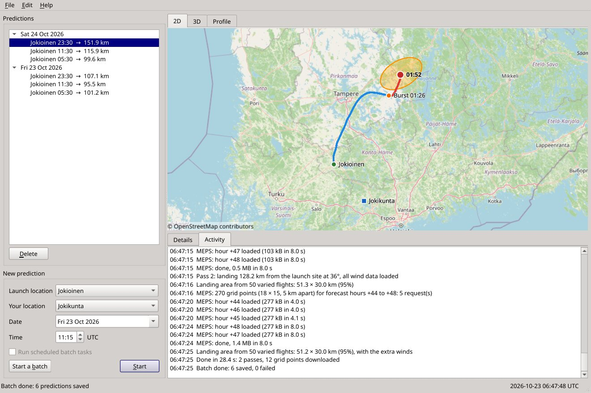
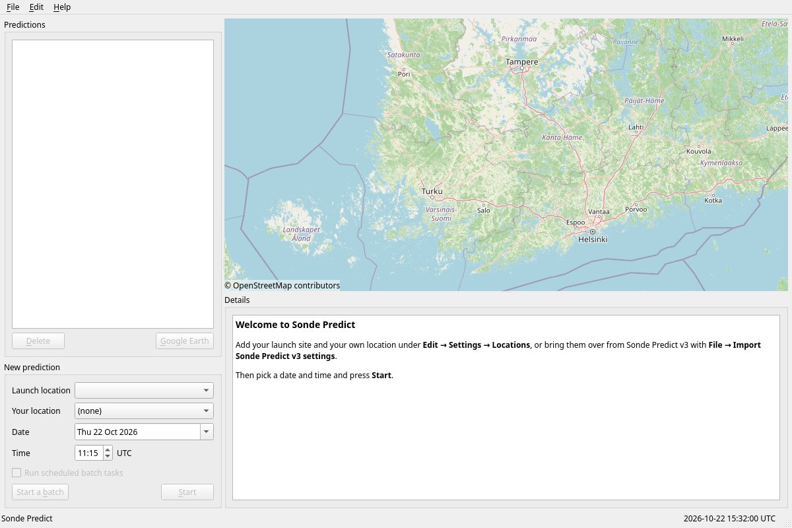
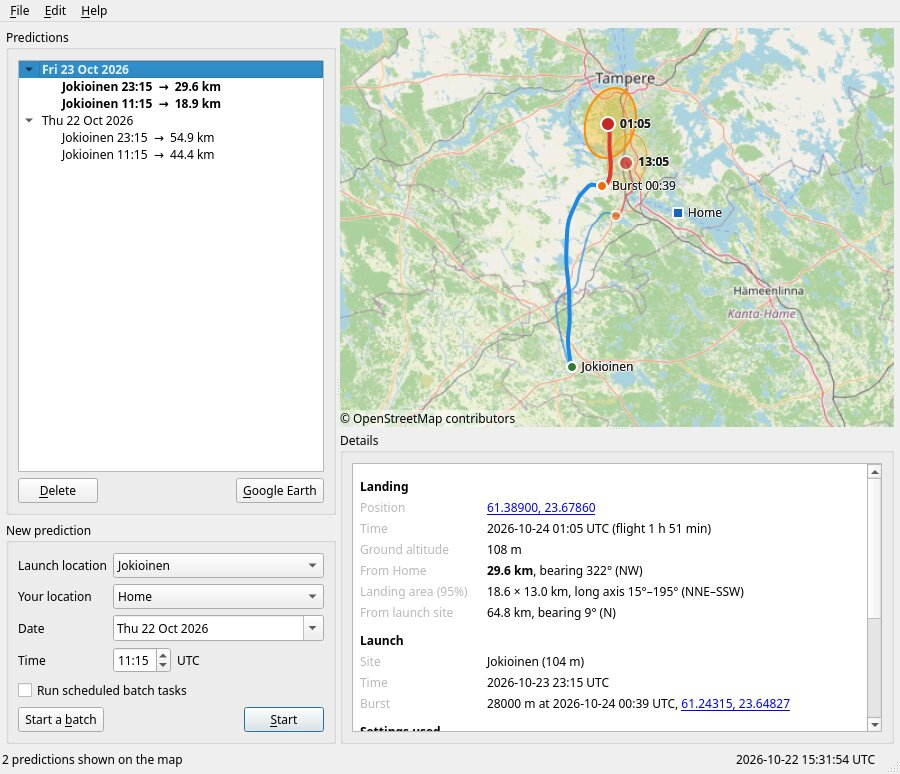
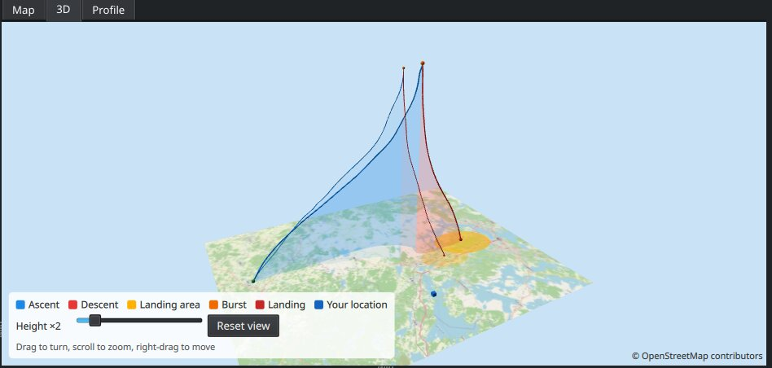
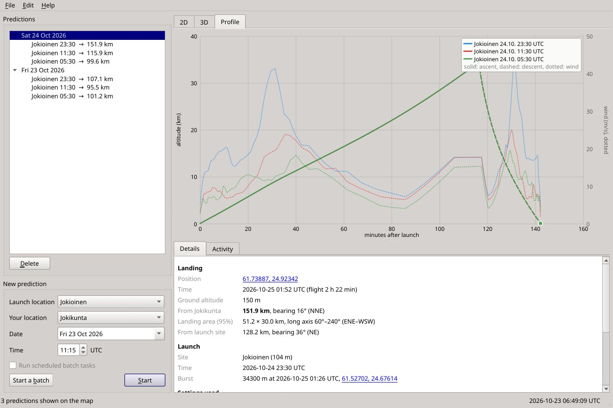
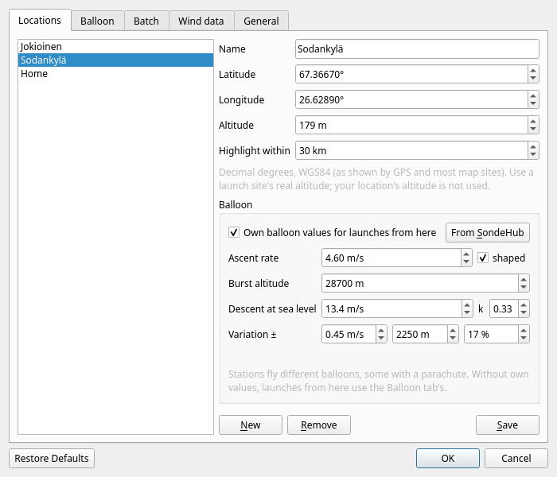
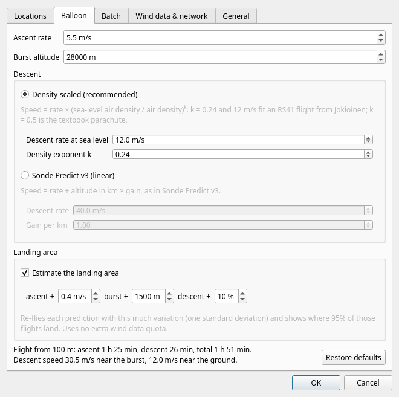
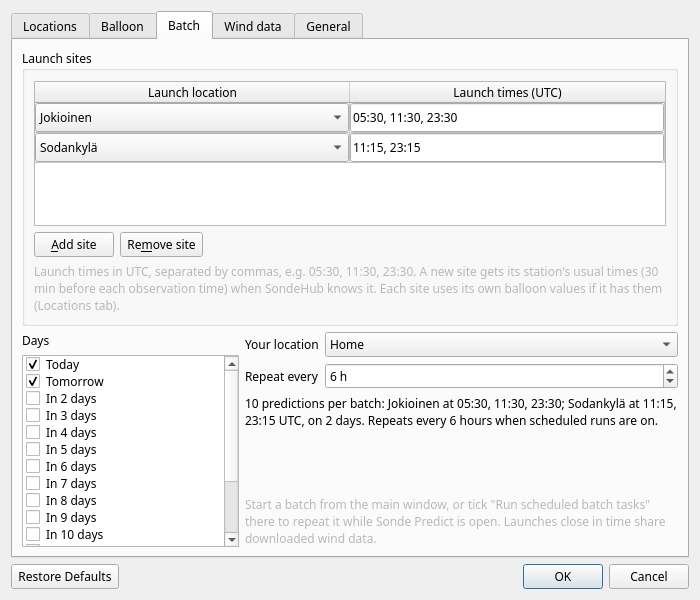
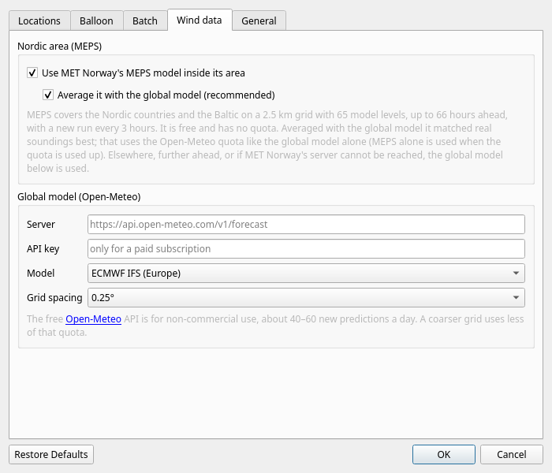
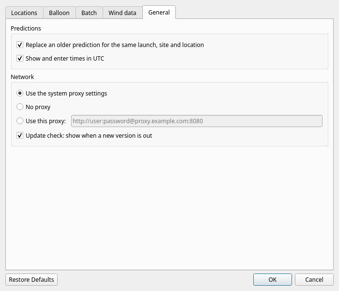

# Sonde Predict 5 — user manual

Sonde Predict calculates where a radiosonde will come down after its weather balloon bursts, so
you can tell at a glance whether a launch is worth hunting. It takes the upper-air wind forecast
(from MET Norway's MEPS model in the Nordic countries, from a global model elsewhere), flies the
balloon through it second by second, and shows the
track, the burst and the landing point on a map, together with the distance and direction from
your own location.

Sonde Predict 5 is a rewrite of Sonde Predict v3 (2016–2022). The idea and the workflow are the
same; what changed is listed in [Coming from Sonde Predict v3](#coming-from-sonde-predict-v3).



## Contents

1. [Installing](#installing)
2. [First start](#first-start)
3. [The main window](#the-main-window)
4. [Making a prediction](#making-a-prediction)
5. [Reading a prediction](#reading-a-prediction)
6. [The 3D view and the altitude profile](#the-3d-view-and-the-altitude-profile)
7. [Batch predictions and the scheduler](#batch-predictions-and-the-scheduler)
8. [Exporting to GPS and phone apps (GPX)](#exporting-to-gps-and-phone-apps-gpx)
9. [Settings](#settings)
10. [Choosing the balloon settings](#choosing-the-balloon-settings)
11. [Wind data and its limits](#wind-data-and-its-limits)
12. [Command line](#command-line)
13. [Troubleshooting](#troubleshooting)
14. [Coming from Sonde Predict v3](#coming-from-sonde-predict-v3)
15. [Where Sonde Predict keeps its files](#where-sonde-predict-keeps-its-files)
16. [Credits](#credits)

## Installing

Download Sonde Predict from <https://github.com/oh2gba/SondePredict/releases/latest>.

**Windows** (Windows 10 and 11, 64-bit): run `SondePredict-windows-x64-setup.exe`.
It installs for your user account only, unless you choose otherwise, and adds a Start menu entry.
Uninstall it from *Settings → Apps* like any other program. There is also a zip file: unzip it
anywhere and start `sondepredict.exe`, as with v3 (`SondePredict-windows-x64.zip`). Windows may warn that the installer comes
from an unknown publisher; choose *More info → Run anyway*.

**Linux** (most distributions from 2022 on): download `SondePredict-x86_64.AppImage`, make it
executable and start it:

```bash
chmod +x SondePredict-x86_64.AppImage
```

```bash
./SondePredict-x86_64.AppImage
```

If it complains about FUSE, start it with `--appimage-extract-and-run` added, or install your
distribution's `libfuse2` package. To remove Sonde Predict, delete the file (and, if you want, the
folders listed in [Where Sonde Predict keeps its files](#where-sonde-predict-keeps-its-files)).

Sonde Predict needs an internet connection for wind data and map tiles.

## First start



On the first start there are no locations yet. You need at least a **launch location** (the
sounding station) and usually **your location** (where you hunt from). Either:

* add them under **Edit → Settings → Locations** (see [Locations](#locations)), or
* if you used Sonde Predict v3, choose **File → Import Sonde Predict v3 settings** and pick the
  old `config.ini` from the v3 folder. This brings over your locations (with their warning
  distances), balloon settings, grid size, proxy, batch schedule and the
  last choices in the main window. Locations you already have are kept as they are. A summary
  tells you what was imported.

## The main window

The window has the same layout as v3, with a map added.

* **Predictions** (top left): every saved prediction, grouped by launch day, newest first. Each
  entry shows the launch site, the launch time and how far from your location the sonde lands.
  An entry is **bold** when that distance is within your location's *Highlight within*
  distance, so good hunting days stand out without opening anything. A day is bold when any of
  its predictions is. Batch predictions say *(batch)* in their tooltip.
  * Click a prediction to show it. Select several with Ctrl or Shift, or click a day to select
    all of its predictions: they are drawn on the map together, which shows at a glance how
    the landing point moves from launch to launch.
  * **Delete** removes the selected predictions.
* **New prediction** (bottom left): the launch location, your location, the launch date and
  time, **Start**, **Start a batch** and **Run scheduled batch tasks**.
* **2D**, **3D** and **Profile** (top right): the selected predictions on an OpenStreetMap map
  (drag to move, mouse wheel or pinch to zoom), in 3D over the map, or as an altitude profile;
  see [The 3D view and the altitude profile](#the-3d-view-and-the-altitude-profile).
* **Details** (bottom right): the numbers for the selected prediction. Coordinates are links that
  open the spot on openstreetmap.org. You can select text and copy it with Ctrl+C.
* **Activity** (next to Details): what Sonde Predict is doing, line by line — which wind model
  and model run it uses, each download with its size and time, waits for the free quota or a busy
  server, each pass of the calculation and the result. It comes to the front while a prediction or
  batch runs; the same lines go to the log file (**Help → Open log file**).
* **Status bar**: what Sonde Predict is doing, a progress bar while it works, a small
  *Version … available* link when there is a newer version (click it for the download page), and
  the current UTC time.



## Making a prediction

1. Choose the **Launch location** and **Your location**. *Your location* can be *(none)*; the
   prediction then has no distance or highlighting.
2. Choose the **Date** and the **Time** of the launch. The time is in UTC, or in your computer's
   time zone if you switched UTC off under *Settings → General*; the label next to the time
   says which. Dates from 7 days back to 15 days ahead can be chosen.
   Many stations launch about 45 minutes before the synoptic hour (for example 11:15 UTC for the
   12 UTC sounding); use the actual launch time, not the synoptic hour.
3. Press **Start**. The status bar shows the progress: Sonde Predict fetches the winds around the
   launch site, flies the balloon, fetches the winds along the track it found, and flies it again
   until no wind data is missing (usually one or two rounds, a few seconds in all). While it
   runs, **Start** turns into **Stop**, which cancels the calculation.
4. The new prediction is saved, appears in the list and is shown on the map.

If you make a prediction again for the same launch time, launch site and your location, the new
one replaces the old one (unless you switched that off under *Settings → General*). Predictions
made within an hour of each other reuse the wind data already downloaded.

## Reading a prediction

On the map, the ascent is blue and the descent red. The green dot is the launch site, the orange
dot the burst, the red dot the landing (labelled with the landing time), and the blue square
your location. The amber ellipse is the **landing area**.

The details panel shows:

* **Landing**: position, time and flight duration, the ground altitude there, the distance and
  bearing from your location (with a compass direction such as NNE) and from the launch site,
  and the size of the landing area.
* **Launch**: the site with its altitude, the launch time, and the burst altitude, time and
  position.
* **Settings used**: the ascent rate, burst altitude and descent model the prediction was made
  with, which wind model it used and when it was calculated.

### The landing area

A single landing point looks more precise than it is. Real balloons climb a little faster or
slower than planned, burst a kilometre or two higher or lower, and fall at slightly different
speeds, and the forecast winds are never quite right. Sonde Predict therefore flies each
prediction about 50 more times with those values varied, each time also with a small, steady
error added to the wind, and draws the ellipse that contains 95% of the landings. The
details give its size and the direction of its long axis, for example *18.6 × 13.0 km, long
axis 15°–195° (NNE–SSW)*.

The wind error grows with how far ahead the launch is, as forecasts do, so an area for a launch
two days ahead is clearly larger than one for a launch this afternoon. Its size was set from real
flights: in tests against flights that SondeHub's receivers followed to the ground, about 95% of
the sondes came down inside the 95% area.

A long, thin area means the sonde travels along a steady wind and mainly its timing is
uncertain: it will come down somewhere along that line. A rounder area means the wind changes
direction with height or the forecast is less certain. How much the balloon values are varied is
set under [Settings → Balloon](#balloon).

### When the balloon goes very high

The wind forecasts reach up to the 10 hPa level, about 31 km. If the burst altitude is higher,
Sonde Predict keeps using the wind at the highest level and says so in the details.

## The 3D view and the altitude profile

The **3D** tab shows the selected predictions in three dimensions over the map: the ascent (blue) and descent (red) with a see-through
curtain down to the ground, the burst, the landing, the landing area and your location.



* **Drag** to turn the view, **scroll** to zoom, **right-drag** (or drag with two fingers) to
  move it.
* **Reset view** goes back to the starting view, which shows the flight from the side.
* Heights are always shown at true scale (×1), so a 30 km high flight that travels 100 km
  looks rather flat.
* Select several predictions, or a whole day, to compare them; the first one is drawn bolder.
* The map on the ground is downloaded the first time a place is shown in 3D and kept for later.
  The ground is flat, at sea level; hills are not shown.

The 3D tab replaces the Google Earth view of Sonde Predict v3.

The **Profile** tab shows the altitude against the minutes after launch: the steady climb, the
burst, and the descent slowing down as the air gets thicker. The dashed line is the wind speed
along the way (right-hand scale), which shows where the jet stream carried the balloon. Small
arrows along the dashed line show the wind direction, pointing where the wind blows to, with up
as north, as on the map. Hold the
mouse over the chart to read the time, altitude and wind at that moment.

With several predictions selected (for example a whole day), each gets its own colour, listed in
the corner: the ascent is a solid line, the descent dashed, the burst a dot and the landing a
square. Holding the mouse over the chart then lists the altitude and wind of each of them at that
moment, so you can compare launches at a glance.



## Batch predictions and the scheduler

A batch makes predictions for several launch sites, days and launch times in one go, for example
the 05:30, 11:30 and 23:30 UTC launches from Jokioinen and the 11:15 and 23:15 launches from
Sodankylä, for today and the next two days.

1. Set it up under **Edit → Settings → Batch**:
   * **Launch sites**: press **Add site** for each station you follow, pick the launch location
     and write its launch times in UTC, separated by commas (*05:30, 11:30, 23:30*). A new site
     gets its station's usual launch times (30 minutes before each observation time) when
     SondeHub knows the station; check them against the station's real practice. **Remove site**
     takes the selected one out.
   * **Days** (*Today*, *Tomorrow*, *In 2 days*, …), **Your location** and **Repeat every** are
     shared by all sites.

   A line summarises the batch, for example *10 predictions per batch: Jokioinen at 05:30, 11:30,
   23:30; Sodankylä at 11:15, 23:15 UTC, on 2 days*. Each site uses its own balloon values when
   it has them ([Locations](#locations)).
2. Press **Start a batch** in the main window. The status bar shows which launch is being
   calculated (*Batch 2/4: Jokioinen 2026-10-22 23:15 UTC…*), and each prediction appears in
   the list as soon as it is ready. **Stop** cancels the rest of the batch; predictions already
   finished are kept.
3. Tick **Run scheduled batch tasks** to repeat the batch automatically every *Repeat every*
   hours while Sonde Predict is open (the tooltip says when the next run is). This needs a
   repeat interval: with *Repeat every* set to *never*, the batch runs only when you press
   **Start a batch**.

Batch predictions replace older ones for the same launch, so a scheduled batch keeps the list up
to date with the newest forecast. Launches within 12 hours of each other share their wind data,
so a batch costs little more than a single prediction per day.

## Exporting to GPS and phone apps (GPX)

**File → Export selected as GPX (GPS, phone)…** saves the landing and burst points as waypoints
and the tracks as GPX tracks, for GPS receivers and phone navigation apps (OsmAnd, Locus, Organic
Maps, Garmin…). Load the file on your phone before you set off and navigate to the landing
waypoint. From the command line, use `sp-cli --gpx file`; see [Command line](#command-line).

## Settings

Open the settings with **Edit → Settings** (Ctrl+,). Changes take effect when you press **OK**.
**Restore Defaults** at the bottom puts the balloon, landing area, wind data and display settings
back to their defaults (it asks first); your locations, the batch, the proxy and an API key stay.
Nothing changes until you press **OK**, so **Cancel** still undoes it.

### Locations



The list on the left shows your locations. Click one to change it; press **New** for a new one.
Fill in:

* **Name**: shown in the drop-down lists and the prediction list.
* **Latitude** and **Longitude** in decimal degrees (WGS84, as shown by GPS receivers and map
  sites). Southern latitudes and western longitudes are negative.
* **Altitude** in metres above sea level. For a launch site this matters: the flight starts
  there. Your own location's altitude is not used.
* **Highlight within**: predictions landing closer than this to this location are shown in bold
  when it is *your location*.

* **Balloon**: tick **Own balloon values for launches from here** when this station's balloons
  differ from the general ones on the Balloon tab (another balloon size, a parachute). Then set
  the ascent rate (with or without the measured *shaped* ascent), burst altitude, descent speed at
  sea level with its exponent *k*, and their variation for the landing area. **From SondeHub**
  fills them in from the SondeHub launch site within 25 km: the ascent and burst of its flights
  of the last 30 days, and its descent. Manual predictions and batches from this location use
  these values; without them, the Balloon tab's.

Press **Save** to store the location. **Remove** deletes the selected one. A location typed in
but not saved yet is saved when you press OK. Renaming a location keeps the batch and the main
window pointing at it.

### Balloon



* **Typical values for a launch site**: about 320 launch sites around the world that SondeHub's
  receivers track, nearest to your locations first (type part of a name to search). **Use**
  looks up the site's flights of the last 30 days on SondeHub and fills in their median ascent
  rate and burst altitude, the site's descent rate, and how much they vary (for the landing
  area). Without an internet connection it uses SondeHub's long-term averages, which can be
  years old. This is the easiest way to good settings for the station you hunt; use it again now
  and then, as stations change balloons.
* **Ascent rate**: how fast the balloon climbs on average, in m/s. With **Slower around the
  tropopause, faster high up** on (the default) the speed follows the shape measured on real
  flights while keeping that average.
* **Burst altitude**: where the balloon bursts, in metres above sea level.
* **Descent**: how fast the sonde falls. Two models are available:
  * **Density-scaled (recommended)**: the sonde falls faster in thin air high up and slows
    down as the air gets denser. *Descent rate at sea level* is the speed near the ground,
    *Density exponent k* how strongly it changes with height.
  * **Sonde Predict v3 (linear)**: the speed is *Descent rate* plus *Gain per km* for every
    kilometre of altitude, exactly as in v3.
* **Landing area**: *Estimate the landing area* switches the [landing area](#the-landing-area)
  on or off; the three values set how much the ascent rate, burst altitude and descent speed are
  varied (one standard deviation). *Add forecast uncertainty* (on by default) also varies the
  wind, more for launches further ahead.
* The line at the bottom shows how long a flight with these settings takes and how fast the
  sonde falls near the burst and near the ground, so you can see the effect of a change at
  once. **Restore defaults** puts back the defaults.

See [Choosing the balloon settings](#choosing-the-balloon-settings) for good values.

### Batch



See [Batch predictions and the scheduler](#batch-predictions-and-the-scheduler).

### Wind data



* **Use MET Norway's MEPS model inside its area**: on by default. MEPS covers the Nordic
  countries, the Baltic and northern Europe on a 2.5 km grid and is used for launches inside that
  area up to 66 hours ahead. It is free and has no quota. See
  [Wind data and its limits](#wind-data-and-its-limits) for when the global model is used instead.
* **Average it with the global model**: on by default. Inside the MEPS area the winds of MEPS and
  the global model are averaged, which matched real soundings better than either model alone. It
  uses the Open-Meteo quota like the global model does; when that is used up, MEPS alone is used.
* **Global model**: averaged with MEPS inside its area, and used alone outside it, further ahead,
  when MEPS is switched off, or when MET Norway's server cannot be reached. *ECMWF IFS* (the
  default) matched real soundings best; the others are there for comparison.
* **Server** and **API key**: leave empty for Open-Meteo's free service. If you have an Open-Meteo
  subscription, enter `https://customer-api.open-meteo.com/v1/forecast` and your key; a
  self-hosted Open-Meteo server works too.
* **Grid spacing**: the spacing of the global model's wind grid. 0.25° is the most accurate; 0.5°
  or 1° use less of the free quota per prediction.

### General



* **Replace an older prediction for the same launch, site and location**: on by default, as in
  v3. Switch it off to keep every prediction.
* **Show and enter times in UTC**: on by default. When off, times are shown and entered in your
  computer's time zone. Batch launch times are always UTC.
* **Network**: *Use the system proxy settings* works for most people. Choose *Use this proxy* and
  enter an address such as `http://proxy.example.com:8080` (with `user:password@` in front of the
  host name if the proxy needs a login) if your network requires a proxy that the system does not
  know about.
* **Update check**: on by default. When a new version of Sonde Predict is out, a small link
  appears in the status bar. **Help → Check for a new version** looks right away.

## Choosing the balloon settings

Good settings matter more than anything else for a good prediction. How a station's balloons
behave depends on its balloons and how it fills them, much more than on the type of radiosonde, so
the best start is the station's own record: pick it under **Typical values for a launch site** in
[Settings → Balloon](#balloon).

The defaults are Jokioinen's (Finland), from the 345 flights of July–October 2026 that SondeHub's
receivers tracked from launch to landing:

| Setting | Default | Notes |
|---|---|---|
| Ascent rate | 4.9 m/s (± 0.35) | The average from launch to burst. Synoptic soundings climb at 4.5–6.3 m/s. |
| Ascent shape | on | Real balloons climb about 13 % slower than average at 9–18 km and up to 20 % faster above 25 km. |
| Burst altitude | 34 300 m (± 2 500) | Depends on the balloon; 24–37 km is typical. Changes the landing point most. |
| Descent rate at sea level | 11.7 m/s (± 18 %) | 3.5–6 m/s with a parachute (most stations); 10–15 m/s without one, as at Jokioinen. |
| Density exponent k | 0.33 | Fitted, with the descent rate, to 30 Jokioinen descents. 0.5 is the textbook value for a parachute. |

The values in brackets are the default landing-area variation.

Some FMI soundings stop at about 16 km (100 hPa), mostly the night ones. That is the end of the
recorded sounding, not the burst: SondeHub's receivers heard those balloons burst at about 35 km.

The best values are the ones that match the flights you actually receive. The **Burst** line in
the details and the tracks of sondes you received (for example the CSV files written by
RS41Tracker) tell you how your station's balloons behave. `sp-cli` can compare a prediction with
such a file and tell you how far off it was; see [Command line](#command-line).

If you imported v3 settings, your old descent rate and gain are kept as the *Sonde Predict v3
(linear)* model. If you had changed them from v3's defaults, that model is selected, so your
predictions behave as before; otherwise the density-scaled model is used.

## Wind data and its limits

Sonde Predict uses two kinds of wind forecast:

* **MEPS** (MetCoOp Ensemble Prediction System, run by MET Norway with SMHI and FMI), read
  directly from [MET Norway's data server](https://thredds.met.no/). It covers the Nordic
  countries, the Baltic and northern Europe on a 2.5 km grid, with 65 levels that follow the
  terrain near the ground and reach about 31 km. A new run comes every 3 hours (about 3 hours
  after its time) and reaches 66 hours ahead. Sonde Predict uses the winds on the model's own
  levels, every second grid point (5 km), with the height of each level worked out from the
  model's pressure, temperature and humidity. It is used when the launch site is at least 150 km
  inside the MEPS area and the flight ends within the newest run.
* **A global model** through the [Open-Meteo](https://open-meteo.com/) weather service (ECMWF
  IFS by default): the wind at 10 m above ground and at 28 pressure levels from 1000 hPa up to
  10 hPa (about 31 km), on a 0.25° grid, every hour. Used alone everywhere else and further
  ahead, and as a fallback: if MEPS fails (for example when MET Norway's server is busy, or the flight
  drifts out of the MEPS area), the prediction is made again with the global model and the status
  bar says why.

Inside the MEPS area both are used and their winds are averaged: the two models make different
mistakes, so the average is closer to the real wind than either (see the comparison below). If
Open-Meteo's quota is used up, MEPS alone is used there. The details of each prediction say which
model it used. Between grid points, levels and hours the
wind is interpolated.

* **Forecast range**: MEPS 66 hours; the global models about 15 days. In the main window you can
  go up to 7 days back. Forecasts more than 3–4 days ahead are rough; check again closer to the
  launch.
* **Free quota**: MEPS has none (please don't run huge batches every few minutes all the same).
  Open-Meteo's free service needs no account or key; it recognises you by your internet (IP)
  address and allows 600 calls a minute, 5 000 an hour and 10 000 a day for non-commercial use.
  Fetching one grid point counts as about 8.6 calls and a new prediction typically needs 15–20
  grid points (about 140–190 calls), so you can make roughly 60 new predictions a day (in the
  MEPS area, MEPS alone takes over when the quota is used up); predictions that reuse downloaded
  winds cost nothing. Sonde Predict spaces its requests
  out so it stays under the per-minute and per-hour limits: a big batch then simply takes longer,
  and the status bar says when it is waiting. Other programs using Open-Meteo from the same
  internet connection share the same limits.
* **Accuracy**: compared with 37 soundings from Jokioinen (October 2026), using the forecasts that
  were available when each prediction would have been made:

  | Prediction made | MEPS | ECMWF | GFS | MEPS + ECMWF averaged |
  |---|---|---|---|---|
  | 3 hours before launch | 2.7 m/s | 2.8 m/s | 3.2 m/s | **2.5 m/s** (1.1 km) |
  | 12 hours before | 3.0 m/s | 3.1 m/s | 3.4 m/s | **2.8 m/s** (1.5 km) |
  | 24 hours before | 3.6 m/s | 3.6 m/s | 3.8 m/s | **3.4 m/s** (3.0 km) |
  | 48 hours before | 4.7 m/s | 4.6 m/s | 5.8 m/s | **4.5 m/s** (4.4 km) |

  The numbers are the average wind error over the whole ascent; in brackets, how far off the
  predicted position at 10 km altitude was. Most of the remaining error in the landing point
  comes from the balloon (burst altitude) rather than the wind or the calculation. The
  comparison is in `tools/validation` in the source code.

## Command line

`sp-cli` (installed next to the app) makes predictions without the window, for scripts and quick
checks. It uses the same settings and prediction list as the app. A few examples:

```bash
sp-cli --launch Jokioinen --home Home --time 2026-10-23T11:15 --save
```

```bash
sp-cli --launch 60.814,23.499,104 --time 2026-10-23T11:15 --gpx landing.gpx
```

```bash
sp-cli --batch --save
```

```bash
sp-cli --list
```

```bash
sp-cli --export 3,4 --gpx predictions.gpx
```

```bash
sp-cli --launch Jokioinen --time 2026-10-23T11:15 --compare received-flight.csv
```

`--help` lists everything, including the balloon options (`--ascent`, `--burst`, `--descent`,
`--exponent`, `--legacy`), the wind options (`--no-meps` for the global model only, `--meps-only`
for MEPS without averaging, `--model` to choose the global model, for example
`--model gfs_global`), `--csv` for the whole track, `--import-v3`,
`--locations`, `--no-area` and `--verbose`, which prints the same lines as the app's Activity
tab.

## Troubleshooting

**"Could not reach Open-Meteo"** — Sonde Predict cannot connect to the wind data service. Check
your internet connection, then the proxy under *Settings → General*.

**"MEPS … could not be used"** in the status bar — the prediction was made with the global model
instead, for the reason given: MET Norway's server was busy or unreachable, or the flight left the
MEPS area. Nothing needs to be done; MEPS is tried again for the next prediction.

**"Spacing out requests…"** — normal during big batches: Sonde Predict waits so as not to go
over Open-Meteo's free limits.

**"Open-Meteo rate limit reached"** — the per-minute limit was reached anyway, for example
because another program on the same internet connection uses Open-Meteo too. Sonde Predict
waits a minute and continues by itself.

**"Open-Meteo's hourly (or daily) limit for this internet connection is used up"** — Sonde
Predict keeps track of its own calls, also across restarts, but not of other programs or other
computers sharing your internet connection. When the limit is used up anyway, a batch stops at
once and tells you how many launches were not predicted; run it again within the hour (or
tomorrow for the daily limit). A coarser grid spacing uses less of the quota.

**"No wind data available for … (outside the forecast range?)"** — the launch is too far in the
future or the past for the forecast.

**The map stays grey** — map tiles come from tile.openstreetmap.org and need the same internet
access as the wind data. Tiles you have seen are cached and work offline.

**The 3D tab stays empty or shows a message** — it needs working 3D graphics (OpenGL, Vulkan or
Direct3D). Updating the graphics driver usually helps; the 2D and Profile tabs work without it.

**Linux: the window stays empty or grey** — the AppImage could not use your graphics driver
through Wayland. Start it through X11 instead:

```bash
QT_QPA_PLATFORM=xcb ./SondePredict-x86_64.AppImage
```

**Something else** — **Help → Open log file** opens `log.txt`, where Sonde Predict notes what it
did and what went wrong. It is useful to include when you report a problem.

## Coming from Sonde Predict v3

What stayed the same: the window layout, locations with warning distances, bold predictions
close to you, manual predictions by date and time, batches with days and hours, the scheduler,
replacing older predictions, proxy settings and a log file.

What is new or different:

* **Runs on Windows and Linux** (v3 was Windows-only), with an installer.
* **A map in the window**: you see where the sonde lands without opening another program.
* **A built-in 3D view** replaces Google Earth: the flight is shown in 3D over the map inside
  Sonde Predict. The Google Earth (KML) export of v3 is gone; GPX export stays.
* **Wind data from MEPS and Open-Meteo** instead of downloading GFS GRIB files from NOAA's NOMADS
  server; no `wgrib2` needed. The winds are interpolated between grid points, levels and hours (v3 used the
  nearest grid point, level and 3-hour forecast step), and the 10 m wind is used near the ground.
* **The flight starts at the launch site's altitude and ends on the ground** under the track
  (v3 started at sea level and stopped at sea level).
* **A new descent model** that follows the air density; your v3 descent settings are still
  available as the *v3 (linear)* model.
* **Landing area**, **GPX export** and **minutes** in the launch time (v3 had whole hours).
* **The highlight distance comes from your location** (v3 used the launch site's value).
* **Distances and bearings on the WGS84 ellipsoid** (v3 used a flat approximation for the
  bearing).
* **Settings** are stored in your user profile instead of the program folder, so Sonde Predict
  can be installed anywhere.

Old v3 predictions (`data.dat`) are not imported: they were made with forecasts that are long out
of date.

## Where Sonde Predict keeps its files

| What | Windows | Linux |
|---|---|---|
| Settings (`sondepredict.ini`, `window.ini`) | `%LOCALAPPDATA%\SondePredict` | `~/.config/SondePredict` |
| Predictions (`predictions.sqlite`) and `log.txt` | `%LOCALAPPDATA%\SondePredict` | `~/.local/share/SondePredict` |
| Map tile cache and the ground images for the 3D view | `%LOCALAPPDATA%\SondePredict\cache` | `~/.cache/SondePredict` |

The settings file is plain text and can be backed up or copied to another computer.

## Credits

* MEPS weather data by [MET Norway](https://www.met.no/) (MetCoOp: MET Norway, SMHI and FMI),
  licensed under CC BY 4.0.
* Global weather data by [Open-Meteo.com](https://open-meteo.com/), licensed under CC BY 4.0,
  from ECMWF, NOAA, Météo-France, the UK Met Office and Environment Canada.
* Typical balloon values per launch site from [SondeHub](https://sondehub.org/), collected by
  its volunteer receiving stations.
* Map data © [OpenStreetMap](https://www.openstreetmap.org/copyright) contributors, map tiles by
  the OpenStreetMap Foundation.
* Built with [Qt](https://www.qt.io/) (LGPL v3).
* Sonde Predict is free software under the GNU General Public License v3.0; the source is at
  <https://github.com/oh2gba/SondePredict>.
